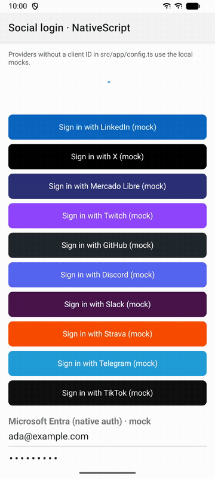

# nativescript-social-login

<p align="center">
  
</p>

<p align="center">

[](https://www.npmjs.com/package/@franciscodlxdev/nativescript-auth-core) [](https://github.com/franciscodlx/nativescript-social-login/actions/workflows/ci.yml) [](LICENSE)

</p>

**Agrega "Iniciar sesión con GitHub, X, LinkedIn, TikTok…" a tu app de NativeScript con una sola API: navegador del sistema, PKCE y cero secrets en la app.**

Sin WebView: el usuario inicia sesión en `ASWebAuthenticationSession` (iOS) o Custom Tabs (Android), con las cookies y gestores de contraseñas que ya usa. El `client_secret` se queda en tu backend, y los errores llegan normalizados (`CANCELLED`, `NETWORK`, `PROVIDER_ERROR`…) sin importar el proveedor.

## Instalación

```sh
ns plugin add @franciscodlxdev/nativescript-auth-core
ns plugin add @franciscodlxdev/nativescript-x-login
```

En Android declara el esquema de tu app en la actividad principal (`App_Resources/Android/src/main/AndroidManifest.xml`); el bloque está en [`nativescript-auth-core`](packages/auth-core#instalación). Funciona con Angular, Vue, Solid o TypeScript sin framework; para NativeScript-Vue hay además un composable, [`nativescript-social-login-vue`](packages/vue).

## Ejemplo mínimo

```ts
import { xLogin } from '@franciscodlxdev/nativescript-x-login';

const { profile } = await xLogin.signIn({
  clientId: 'TU_CLIENT_ID',        // portal de X → OAuth 2.0, app tipo "Native App"
  redirectUri: 'miapp://callback', // regístrala tal cual en X
  exchangeCode: true,              // cliente público: el canje se hace en el dispositivo con PKCE
});

console.log(`Hola, @${profile?.username}`);
```

X es un cliente público, así que este ejemplo no necesita backend. LinkedIn, GitHub, TikTok y los demás devuelven un `code` que tu backend canjea con el secret; cada paquete trae el canje listo en Node y Laravel. Detalles de X en [`packages/x-login`](packages/x-login).

<sub>El GIF: App `examples/demo` (NativeScript + Angular) en el emulador de Android contra el proveedor local (`tools/mock-idp`). Probado también con cuentas reales de LinkedIn, X, GitHub, Discord, Telegram y TikTok en iPhone.</sub>

## Paquetes

| Paquete                                                                  | Qué hace                                                           | Estado             |
| ------------------------------------------------------------------------ | ------------------------------------------------------------------ | ------------------ |
| [`@franciscodlxdev/nativescript-auth-core`](packages/auth-core)              | PKCE, `state`/`nonce`, navegador del sistema, errores normalizados | Probado en iPhone y Android |
| [`@franciscodlxdev/nativescript-linkedin-login`](packages/linkedin-login)    | LinkedIn con OpenID Connect                                        | Probado con LinkedIn |
| [`@franciscodlxdev/nativescript-x-login`](packages/x-login)                  | X con OAuth 2.0 + PKCE                                             | Probado con X |
| [`@franciscodlxdev/nativescript-mercadolibre-login`](packages/mercadolibre-login) | Mercado Libre con selector de país                            | Probado con mock   |
| [`@franciscodlxdev/nativescript-twitch-login`](packages/twitch-login)        | Twitch con OIDC                                                    | Probado con mock   |
| [`@franciscodlxdev/nativescript-oauth-presets`](packages/oauth-presets)      | GitHub, Discord, Slack y Strava                                    | Probado con GitHub, Discord |
| [`@franciscodlxdev/nativescript-telegram-login`](packages/telegram-login)    | Telegram con OpenID Connect                                        | Probado con Telegram |
| [`@franciscodlxdev/nativescript-tiktok-login`](packages/tiktok-login)        | TikTok Login Kit (flujo web)                                       | Probado con TikTok (sandbox) |
| [`@franciscodlxdev/nativescript-entra-native-auth`](packages/entra-native-auth) | Entra External ID: alta, login y reset sin navegador            | Probado con mock   |
| [`@franciscodlxdev/nativescript-social-login-vue`](packages/vue)            | Composable `useProviderLogin` para NativeScript-Vue                | Probado con mock (Android) |

"Probado con mock": iOS (simulador) y Android (emulador) contra `tools/mock-idp` y los backends de `tools/`. "Probado con <proveedor>": además, con una cuenta real en iPhone.

Cada proveedor es un paquete independiente (versión, changelog y publicación propios) que solo aporta endpoints, scopes y mapeo de perfil; el flujo y la seguridad viven en el núcleo. Los paquetes no dependen de Angular: funcionan igual con Vue, Solid o TypeScript sin framework.

## Estructura

```
packages/auth-core          núcleo (acceso nativo desde TypeScript: ASWebAuthenticationSession y Custom Tabs)
packages/<proveedor>        un paquete TypeScript por proveedor sobre el núcleo
examples/demo               app NativeScript + Angular con todos los proveedores
examples/demo-vue           la misma app con NativeScript-Vue (X usa el composable useProviderLogin)
tools/mock-idp              proveedor OAuth/OIDC local, sin credenciales reales
tools/mock-entra            imita la API de native authentication de Entra
tools/<proveedor>-backend   backends de ejemplo: redirect https y canje con el secret
```

## Desarrollo

Requiere Node 24, pnpm 12, Xcode, CocoaPods y Android SDK con JDK 17.

```sh
pnpm install
pnpm test          # pruebas unitarias (vitest)
pnpm typecheck
pnpm lint
pnpm build
```

Probar el flujo completo, sin cuenta en ningún proveedor: ver [CONTRIBUTING.md](CONTRIBUTING.md). Vulnerabilidades: [SECURITY.md](SECURITY.md).

## La familia

La misma API, los mismos proveedores y los mismos códigos de error en cada plataforma:

| Plataforma | Repositorio |
| ---------- | ----------- |
| React Native (y Expo) | [rn-social-login](https://github.com/franciscodlx/rn-social-login) |
| Flutter | [flutter_social_login](https://github.com/franciscodlx/flutter_social_login) |
| Capacitor / Ionic | [capacitor-social-login](https://github.com/franciscodlx/capacitor-social-login) |
| NativeScript | **este repo** |
| NativePHP Mobile | [nativephp-social-login](https://github.com/franciscodlx/nativephp-social-login) |

## Licencia

MIT
