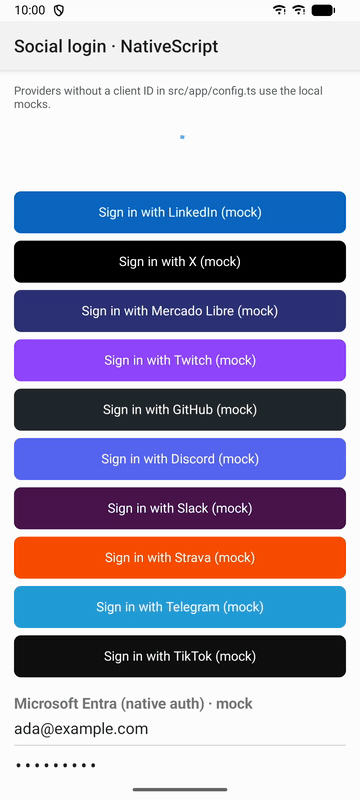

# @franciscodlxdev/nativescript-auth-core

<p align="center"></p>

OAuth 2.0 + PKCE para NativeScript (iOS, Android) en el navegador del sistema: `ASWebAuthenticationSession` en iOS y Custom Tabs en Android. Sin WebView y sin `clientSecret` en la app. Es el núcleo de la familia: cada proveedor (LinkedIn, X, GitHub, …) es un paquete aparte que solo aporta endpoints, scopes y el mapeo del perfil.

## Compatibilidad

| Paquete | NativeScript | Sabores                           | iOS    | Android        |
| ------- | ------------ | --------------------------------- | ------ | -------------- |
| 0.1.x   | 9 (probado)  | Angular (probado), Vue, Solid, TS | ≥ 15.0 | ≥ 7.0 (API 24) |

## Instalación

```sh
ns plugin add @franciscodlxdev/nativescript-auth-core
```

No trae código Swift ni Kotlin: llama a `ASWebAuthenticationSession` y a Custom Tabs directamente desde TypeScript, con el acceso nativo de NativeScript. Tampoco depende de `androidx.browser`.

**iOS**: nada más. `ASWebAuthenticationSession` recibe el redirect `miapp://…` sin registrar el esquema en `Info.plist`. El plugin enlaza `AuthenticationServices` por su cuenta.

**Android**: el redirect vuelve a la actividad principal de la app (`com.tns.NativeScriptActivity`, que ya es `singleTask` en la plantilla). Agrégale un `intent-filter` con tu esquema en `App_Resources/Android/src/main/AndroidManifest.xml`:

```xml
<activity android:name="com.tns.NativeScriptActivity" android:launchMode="singleTask" ...>
    <!-- el intent-filter MAIN/LAUNCHER que ya tienes -->
    <intent-filter>
        <action android:name="android.intent.action.VIEW" />
        <category android:name="android.intent.category.DEFAULT" />
        <category android:name="android.intent.category.BROWSABLE" />
        <data android:scheme="miapp" />
    </intent-filter>
</activity>
```

Puedes listar varios `<data android:scheme="…"/>`, o agregar otro `intent-filter` para un App Link https. Si falta, `signIn` falla de inmediato con `INVALID_CONFIG` en lugar de dejar el navegador abierto sin regreso. Las `<queries>` para encontrar navegadores en Android 11+ las agrega el plugin.

`fetch` en NativeScript usa HTTP nativo, así que no hay problemas de CORS con tu backend ni con los proveedores.

## Configurar el proveedor

1. Crea la app en el portal del proveedor como cliente **público / nativo** (sin secret).
2. Registra el redirect URI: `miapp://callback`, o un Universal Link / App Link.
3. Anota el `clientId` y los scopes.

## Uso

```ts
import { createProviderLogin } from '@franciscodlxdev/nativescript-auth-core';

const login = createProviderLogin({
  id: 'mi-idp',
  authorizationEndpoint: 'https://idp.example.com/authorize',
  tokenEndpoint: 'https://idp.example.com/token', // solo si el proveedor admite clientes públicos
  userInfoEndpoint: 'https://idp.example.com/userinfo',
  issuer: 'https://idp.example.com',
  defaultScopes: ['openid', 'profile', 'email'],
  useNonce: true,
});

const { code, codeVerifier, nonce, redirectUri } = await login.signIn({
  clientId: 'TU_CLIENT_ID',
  redirectUri: 'miapp://callback',
});
// Envía code + codeVerifier + redirectUri a tu backend.
```

Con Angular, envuélvelo en un servicio o en un `signal`; con Vue o Solid, en tu propio estado. El paquete no depende de ningún framework.

### API

| Función                                                              | Devuelve                                                                                                                                                           |
| -------------------------------------------------------------------- | ------------------------------------------------------------------------------------------------------------------------------------------------------------------ |
| `signIn(options)`                                                    | `{ code, codeVerifier, state, nonce?, redirectUri, params }`; con `exchangeCode: true` agrega `accessToken`, `refreshToken`, `idToken`, `idTokenClaims`, `profile` |
| `signOut({ clientId, token })`                                       | Revoca el token si el proveedor tiene endpoint de revocación                                                                                                       |
| `isAvailable()`                                                      | `Promise<boolean>`: si se puede abrir el navegador del sistema                                                                                                     |
| `authorize(request)` / `cancelAuthorize()`                           | El flujo sin proveedor predefinido / cerrar el navegador abierto                                                                                                   |
| `exchangeCode`, `refreshAccessToken`, `revokeToken`, `fetchUserInfo` | Llamadas de cliente público al proveedor                                                                                                                           |
| `decodeIdToken`, `validateIdTokenClaims`                             | Claims del `id_token` y revisión de `iss`, `aud`, `exp`, `nonce`                                                                                                   |
| `createPkcePair()`, `randomString()`                                 | PKCE S256 y aleatorios del CSPRNG nativo (asíncronos)                                                                                                              |

Opciones de `signIn`: `clientId`, `redirectUri`, `callbackUri`, `scopes`, `extraParams`, `prefersEphemeralSession` (no comparte cookies con el navegador; en iOS además evita el aviso de confirmación), `exchangeCode`.

### Proveedores que solo aceptan redirect https

Si el proveedor no admite `miapp://…`, registra una URL https de tu backend como `redirectUri` y haz que reenvíe la query a tu app; `callbackUri` es la URL donde la app espera:

```ts
login.signIn({
  clientId,
  redirectUri: 'https://api.miapp.com/auth/callback', // lo ve el proveedor
  callbackUri: 'miapp://callback', // lo recibe la app
});
```

## Backend (canje del código)

Si el proveedor exige `client_secret`, el canje va en tu servidor. Node/Express:

```js
app.post('/auth/exchange', async (req, res) => {
  const { code, codeVerifier, redirectUri } = req.body;
  const r = await fetch('https://idp.example.com/token', {
    method: 'POST',
    headers: { 'Content-Type': 'application/x-www-form-urlencoded' },
    body: new URLSearchParams({
      grant_type: 'authorization_code',
      code,
      code_verifier: codeVerifier,
      redirect_uri: redirectUri,
      client_id: process.env.CLIENT_ID,
      client_secret: process.env.CLIENT_SECRET,
    }),
  });
  res.status(r.status).json(await r.json());
});
```

## Errores normalizados

Todo falla con un `AuthError` cuyo `code` es uno de:

| Código           | Cuándo                                                                                         |
| ---------------- | ---------------------------------------------------------------------------------------------- |
| `CANCELLED`      | El usuario cerró el navegador o rechazó el permiso (`access_denied`)                           |
| `NETWORK`        | No se pudo contactar al proveedor                                                              |
| `INVALID_CONFIG` | Falta `clientId` / `redirectUri`, endpoint sin https, esquema sin `intent-filter` o login abierto |
| `PROVIDER_ERROR` | El proveedor devolvió un error, el `state` no coincide o el `id_token` no es válido            |
| `NOT_SUPPORTED`  | Sin navegador, fuera de iOS/Android, o redirect https en iOS < 17.4                            |

`error.providerError` y `error.providerErrorDescription` traen lo que respondió el proveedor.

## Seguridad

- No hay `clientSecret` en la app: PKCE (S256) liga el código al dispositivo que lo pidió.
- `state` y `nonce` salen del CSPRNG nativo; un redirect con otro `state` se rechaza.
- En Android solo se acepta el redirect del inicio de sesión en curso (mismo esquema, host y ruta).
- El `id_token` se decodifica **sin verificar la firma**; verifícala en tu backend.
- La librería no guarda tokens. Usa Keychain / Keystore (p. ej. `@nativescript/secure-storage`).
- http solo se acepta hacia `localhost`, `127.0.0.1` y `10.0.2.2`, para el servidor de pruebas.

Más en [SECURITY.md](../../SECURITY.md).

## Probar sin credenciales

`examples/demo` (NativeScript + Angular) corre todos los proveedores contra `tools/mock-idp`, un proveedor OIDC local. Ver [CONTRIBUTING.md](../../CONTRIBUTING.md).

## Licencia

MIT
